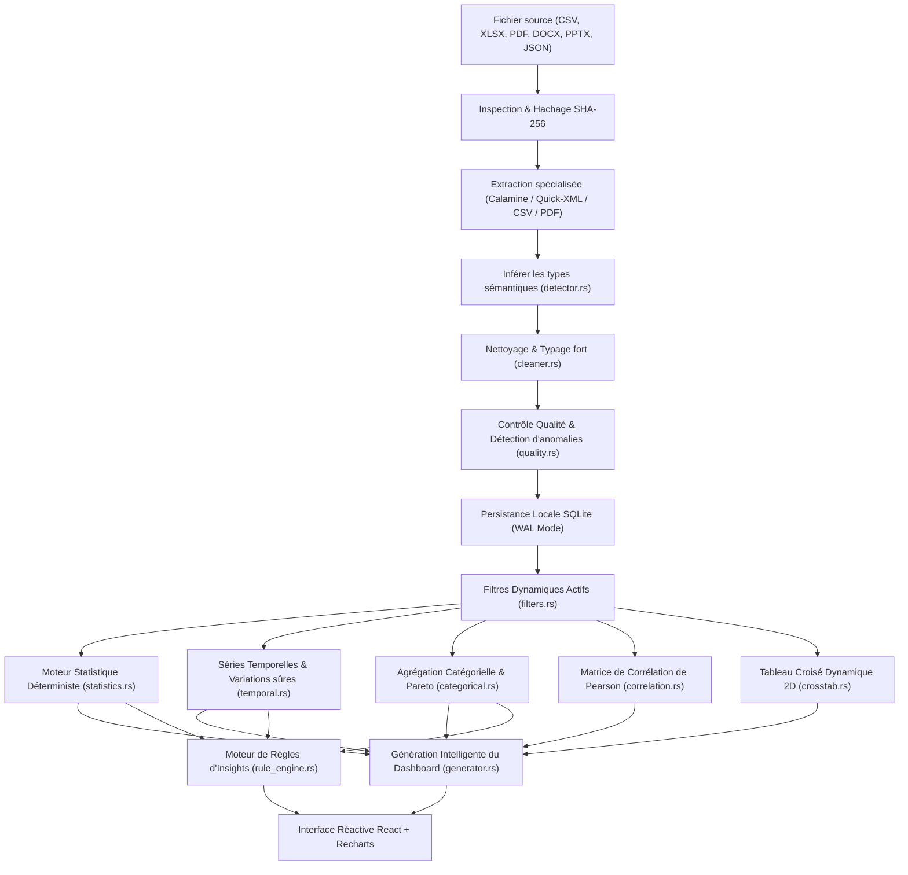

# Architecture Logicielle — InsightDesk

Ce document détaille l'organisation interne, le cycle de vie des données, les choix de conception et les garanties de sécurité d'InsightDesk.

---

## 1. Vue d'Ensemble & Pipeline de Données

Le traitement documentaire suit un flux déterministe strict en 15 étapes :

---

## 2. Modèle de Persistance SQLite

La base de données locale `insightdesk.db` utilise SQLite 3 (embarqué statiquement via `rusqlite` avec la fonctionnalité `bundled`).
Avantages :
- Zéro dépendance système externe ou DLL introuvable.
- Mode **WAL (Write-Ahead Logging)** activé pour des lectures concurrentes ultra-rapides.
- Intégrité référentielle avec `PRAGMA foreign_keys = ON`.
- Les données volumineuses ne saturent pas la mémoire : elles sont partitionnées et normalisées.

Tables principales :
- `projects` : Espaces de travail avec statut démo et horodatage.
- `documents` : Fichiers sources avec empreinte SHA-256 pour éviter les doublons.
- `datasets` : Jeux de données nettoyés avec colonnes typées.
- `dataset_columns` : Schémas et types sémantiques (MetricAmount, DimensionCategory, DimensionDate).
- `analysis_runs` : Historique des calculs et configurations.
- `metrics` : Valeurs de KPI et formules de calcul associées.
- `dashboards` : Mises en page adaptées aux données.
- `insights` : Alertes, anomalies IQR et recommandations opérationnelles.
- `application_settings` : Préférences utilisateur (thème, devises, formats, options IA).

---

## 3. Moteur Statistique Déterministe

### Gestion sécurisée des variations
Une variation relative entre deux périodes $P_1$ et $P_2$ est calculée selon la formule :
$$\Delta\% = \frac{V_2 - V_1}{|V_1|} \times 100$$
Dans le cas où la période de référence $V_1 = 0$, le moteur statistique ne renvoie jamais `NaN` ou `+Infinity`. La valeur est convertie en `None` et annotée comme période initiale ou variation non calculable.

### Détection des anomalies par l'écart interquartile (IQR)
Pour toute métrique continue :
$$IQR = Q_3 - Q_1$$
$$\text{Borne inférieure} = Q_1 - 1.5 \times IQR$$
$$\text{Borne supérieure} = Q_3 + 1.5 \times IQR$$
Toute valeur franchissant ces bornes génère un constat d'anomalie avec indication du maximum constaté et renvoi vers l'inspecteur de ligne source.

---

## 4. Sécurité & Confidentialité

- **Isolation des processus** : Le frontend React s'exécute dans un contexte de vue sécurisé sans accès direct au système de fichiers (IPC Tauri strict avec validation des chemins).
- **Protection des clés API** : Si un fournisseur externe LLM est utilisé, la clé API reste stockée dans la table locale SQLite sans jamais transiter vers un serveur tiers.
- **Principe du moindre privilège** : Aucune commande shell arbitraire n'est exécutable depuis l'interface utilisateur.
- **Zéro télémétrie non sollicitée** : L'option de télémétrie est désactivée par défaut dans les paramètres.
